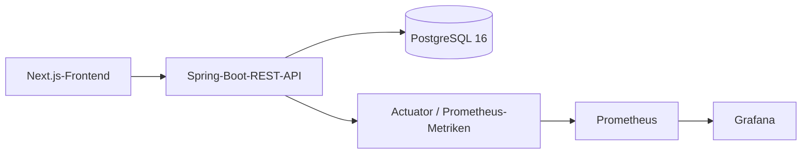
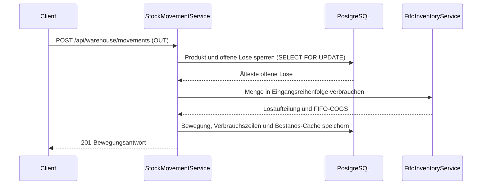

# Warehouse-Management-System (WMS)

**Sprache:** [Türkçe](README.md) · [English](README.en.md) · [Deutsch](README.de.md)

[](https://github.com/eucardeveloper/inventory-management-api/actions/workflows/ci.yml) [](https://github.com/eucardeveloper/inventory-management-api/actions/workflows/owasp.yml)

## Projektüberblick

Dieses Repository enthält ein Warehouse-Management-System (WMS) mit einem Spring-Boot-Backend und einem Next.js-Frontend. Es unterstützt authentifizierte Lagerbewegungen, FIFO-Losverwaltung, rollenbasierte Zugriffssteuerung, Audit-Logging sowie Betriebsmetriken für Prometheus und Grafana.

Der vollständige Stack einschließlich PostgreSQL und Monitoring lässt sich für Demos und technische Reviews mit Docker Compose starten.

## Funktionen

- Verwaltung von Produkten und Lieferanten
- Lagerbewegungen für Zugang, Abgang und Rückbuchung
- FIFO-basierte Losverfolgung, Bewertung und Bestandsberichte
- Kumulativer `stock_after`-Bestand je Bewegung
- JWT-Authentifizierung in HttpOnly-Cookies mit Rotation der Refresh-Tokens
- Rollenbasierte Zugriffskontrolle für `ADMIN`, `WAREHOUSE_MANAGER` und `STAFF`
- Audit-Log-Endpunkte und AOP-basierte Audit-Aufzeichnung
- Prometheus-Metriken und ein vorkonfiguriertes Grafana-Dashboard
- Swagger UI und OpenAPI-Dokumentation
- Export im Frontend als CSV, XLSX und PDF

## Technologie-Stack

| Schicht | Technologie |
|---|---|
| Backend | Java 21, Spring Boot 3.5.4, Spring Security, Spring Data JPA |
| Frontend | Next.js 16.3.0, React 19, TypeScript, Tailwind CSS, TanStack Query |
| Datenbank | PostgreSQL 16, Flyway |
| Authentifizierung | JWT, HttpOnly-Cookies, gespeicherte Refresh-Tokens |
| Observability | Spring Boot Actuator, Micrometer-Prometheus-Registry, Prometheus, Grafana |
| Tests | JUnit 5, Spring Boot Test, Testcontainers PostgreSQL, ArchUnit |
| Auslieferung | Docker, Docker Compose, GitHub Actions |

## Gesamten Stack starten

Voraussetzungen: Docker Desktop und Git.

```bash
git clone https://github.com/eucardeveloper/inventory-management-api.git
cd inventory-management-api
docker compose up --build
```

Der erste Build kann einige Minuten dauern. Die Datenbank wird durch Flyway initialisiert und enthält Demo-Daten.

## Demo-Benutzer

| Benutzername | Passwort | Rolle |
|---|---|---|
| `admin` | `admin123` | `ADMIN` |
| `warehouse` | `warehouse123` | `WAREHOUSE_MANAGER` |
| `staff` | `staff123` | `STAFF` |

Diese Zugangsdaten dienen ausschließlich der Demo und dürfen nicht in der Produktion verwendet werden.

## Service-URLs

| Service | URL |
|---|---|
| WMS-Frontend | http://localhost:3002 |
| Backend-API | http://localhost:8083 |
| Swagger UI | http://localhost:8083/swagger-ui.html |
| Prometheus | http://localhost:9090 |
| Grafana | http://localhost:3001 |
| PostgreSQL (Host-Port) | `localhost:5436` |

Der lokale Grafana-Login lautet `admin` / `admin`, sofern nicht `GRAFANA_PASSWORD` gesetzt wird.

## Rollen und Berechtigungen

Alle authentifizierten Rollen dürfen API-Ressourcen lesen, Lagerbewegungen erfassen sowie Dashboard, Produkte, Bewegungen und Bestandsberichte anzeigen. Die folgende Tabelle beschreibt die zusätzlichen Einschränkungen des Backends:

| Funktion | ADMIN | WAREHOUSE_MANAGER | STAFF |
|---|:---:|:---:|:---:|
| API-Ressourcen und Bestandsberichte lesen | Ja | Ja | Ja |
| Lagerbewegungen erfassen | Ja | Ja | Ja |
| Produkte und Lieferanten anlegen/ändern | Ja | Ja | Nein |
| Lagerbewegung rückbuchen | Ja | Ja | Nein |
| Lieferanten löschen | Ja | Nein | Nein |
| Benutzer und Rollen verwalten | Ja | Nein | Nein |
| Geschützte Actuator-Endpunkte aufrufen | Ja | Nein | Nein |

Authentifizierungs-Endpunkte, Swagger/OpenAPI, Health/Info/Metriken und der Prometheus-Endpunkt sind gemäß der Security-Konfiguration öffentlich erreichbar.

## Architekturüberblick

Das System ist als modularer Monolith aufgebaut: Das Spring-Boot-Backend verantwortet Authentifizierung, Autorisierung, Geschäftsregeln, Persistenz, FIFO-Bestandslogik und Audit-Logging. Das Next.js-Frontend nutzt die REST-API; PostgreSQL speichert Transaktionsdaten und Refresh-Token-Datensätze. Prometheus liest Actuator-Metriken aus, Grafana visualisiert sie, und Docker Compose verbindet die Services für den lokalen Betrieb.



### FIFO-Ablauf einer OUT-Lagerbewegung



## CI/CD

GitHub Actions führt bei Pushes sowie bei Pull Requests gegen `main` folgende Pipeline aus:

1. Unit- und Slice-Tests mit Java 21.
2. Integrationstests mit Testcontainers und einem echten PostgreSQL-Container.
3. Bei einem Push auf `main` wird ein Docker-Image gebaut und nach GHCR als `ghcr.io/eucardeveloper/warehouse-wms` veröffentlicht.

Ein OWASP-Dependency-Check läuft wöchentlich montags um 08:00 UTC und kann manuell gestartet werden. Nicht unterdrückte Befunde ab CVSS 7 lassen den Workflow fehlschlagen; der geprüfte Suppression-Stand liegt im Repository. Zusätzlich führt die Frontend-CI ESLint, einen Production-Build und `npm audit --audit-level=high` aus. Fünf High-Befunde bleiben derzeit in der transitiven `braces`-Kette von `eslint-config-next`; npm bietet dafür nur den nicht akzeptierten Breaking-Change-Weg mit `--force` an.

## Testabdeckung

- FIFO-Unit-Tests prüfen Losreihenfolge, COGS über mehrere Lose, unzureichenden Bestand, Eingangsvalidierung, Erschöpfung und die Wiederherstellung bei einer OUT-Rückbuchung.
- PostgreSQL-/Testcontainers-Integrationstests prüfen parallele Entnahmen, nicht-negativen Bestand und doppelte Idempotency Keys.
- Product- und Supplier-Service-Tests prüfen grundlegendes Service-/Repository-Verhalten.
- ArchUnit-Tests prüfen die vorgesehene Schichtung der Pakete.

Die Testcontainers-Tests benötigen Docker. Unter Windows muss Docker Desktop mit aktivierter Linux-Engine laufen; Surefire übergibt für den gebündelten Testcontainers-Client `api.version=1.44`, danach genügt `./mvnw test`. Wenn kein Docker-Daemon erreichbar ist, können Tests weiterhin durch die Repository-Bedingung übersprungen werden; ein grüner Maven-Build beweist dann nicht das Sperrverhalten von PostgreSQL. Mit Docker Desktop wurden zuletzt 45 Tests mit 0 Fehlern, 0 Failures und 0 übersprungenen Tests ausgeführt. Autorisierung, Origin/Referer, Login-Rate-Limiting und parallele Refresh-Szenarien sind durch Security-/Integrationstests abgedeckt.

## Wichtige API-Bereiche

```text
POST /api/auth/login
POST /api/auth/refresh
POST /api/auth/logout
GET  /api/products
POST /api/products
GET  /api/warehouse/movements
POST /api/warehouse/movements
POST /api/warehouse/movements/{id}/reverse
GET  /api/warehouse/report
GET  /api/audit
GET  /api/users
```

Die vollständigen Request- und Response-Verträge sind in der Swagger UI beschrieben.
