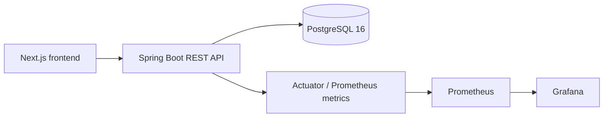
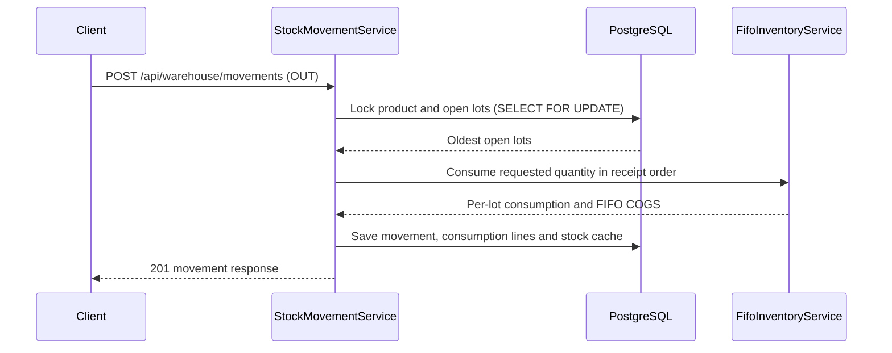

# Warehouse Management System (WMS)

**Language:** [Türkçe](README.md) · [English](README.en.md) · [Deutsch](README.de.md)

[](https://github.com/eucardeveloper/inventory-management-api/actions/workflows/ci.yml) [](https://github.com/eucardeveloper/inventory-management-api/actions/workflows/owasp.yml)

## Project overview

This repository contains a warehouse management system (WMS) with a Spring Boot backend and a Next.js frontend. It provides authenticated inventory operations, FIFO lot consumption, role-based access control, audit logging, and operational metrics for Prometheus and Grafana.

The repository is suitable for local demonstrations and technical review: the complete stack, including PostgreSQL and monitoring, can be started with Docker Compose.

## Features

- Product and supplier master data management
- Stock IN, OUT, and reversal movements
- FIFO-based lot tracking, valuation, and stock reports
- Cumulative `stock_after` tracking for movements
- JWT authentication in HttpOnly cookies with refresh-token rotation
- Role-based access control for `ADMIN`, `WAREHOUSE_MANAGER`, and `STAFF`
- Audit log endpoints and AOP-based audit recording
- Prometheus metrics and a provisioned Grafana dashboard
- Swagger UI and OpenAPI documentation
- CSV, XLSX, and PDF export in the frontend

## Technology stack

| Layer | Technology |
|---|---|
| Backend | Java 21, Spring Boot 3.5.4, Spring Security, Spring Data JPA |
| Frontend | Next.js 16.3.0, React 19, TypeScript, Tailwind CSS, TanStack Query |
| Database | PostgreSQL 16, Flyway |
| Authentication | JWT, HttpOnly cookies, persisted refresh tokens |
| Observability | Spring Boot Actuator, Micrometer Prometheus registry, Prometheus, Grafana |
| Testing | JUnit 5, Spring Boot Test, Testcontainers PostgreSQL, ArchUnit |
| Delivery | Docker, Docker Compose, GitHub Actions |

## Run the complete stack

Requirements: Docker Desktop and Git.

```bash
git clone https://github.com/eucardeveloper/inventory-management-api.git
cd inventory-management-api
docker compose up --build
```

The first build may take several minutes. The database is initialized by Flyway and includes demo data.

## Demo users

| Username | Password | Role |
|---|---|---|
| `admin` | `admin123` | `ADMIN` |
| `warehouse` | `warehouse123` | `WAREHOUSE_MANAGER` |
| `staff` | `staff123` | `STAFF` |

These credentials are demo seed data and must not be used as production credentials.

## Service URLs

| Service | URL |
|---|---|
| WMS frontend | http://localhost:3002 |
| Backend API | http://localhost:8083 |
| Swagger UI | http://localhost:8083/swagger-ui.html |
| Prometheus | http://localhost:9090 |
| Grafana | http://localhost:3001 |
| PostgreSQL (host port) | `localhost:5436` |

The local Grafana login is `admin` / `admin` unless `GRAFANA_PASSWORD` is supplied.

## Role and permission overview

All authenticated roles can read API resources, record stock movements, view the dashboard, products, movements, and stock reports. The permissions below describe the additional restrictions implemented by the backend:

| Capability | ADMIN | WAREHOUSE_MANAGER | STAFF |
|---|:---:|:---:|:---:|
| Read API resources and stock reports | Yes | Yes | Yes |
| Record stock movements | Yes | Yes | Yes |
| Create/update products and suppliers | Yes | Yes | No |
| Reverse a stock movement | Yes | Yes | No |
| Delete suppliers | Yes | No | No |
| Manage users and roles | Yes | No | No |
| Access protected Actuator endpoints | Yes | No | No |

Authentication endpoints, Swagger/OpenAPI, health/info/metrics, and the Prometheus endpoint are publicly reachable according to the security configuration.

## Architecture overview

The system is organized as a modular monolith: a Spring Boot REST API owns authentication, authorization, business rules, persistence, FIFO inventory operations, and audit logging. A Next.js frontend consumes the API; PostgreSQL stores transactional data and refresh-token records; Prometheus scrapes Actuator metrics and Grafana visualizes them. Docker Compose wires these services together for local use.



### FIFO flow for an OUT movement



## CI/CD

GitHub Actions runs the following pipeline on pushes and on pull requests targeting `main`:

1. Unit and slice tests on Java 21.
2. Integration tests using Testcontainers and a real PostgreSQL container.
3. On a push to `main`, a Docker image is built and pushed to GHCR as `ghcr.io/eucardeveloper/warehouse-wms`.

An OWASP Dependency Check workflow runs weekly on Monday at 08:00 UTC and can also be started manually. Its report is uploaded as an artifact; the workflow is configured to continue after a scan failure.

## Test coverage

- FIFO unit tests cover lot ordering, multi-lot COGS, insufficient stock, receiving validation, exhaustion, and OUT reversal restoration.
- PostgreSQL/Testcontainers integration tests cover concurrent withdrawals, non-negative stock, and duplicate idempotency keys.
- Product and supplier service tests cover basic service/repository behavior.
- ArchUnit tests cover the intended package layering.

The Testcontainers tests require Docker. On Windows with Docker Desktop, make sure the Linux engine is running and execute `./mvnw test`; `src/test/resources/testcontainers.properties` pins a compatible Docker API version for the bundled Testcontainers client. When no Docker daemon is available, those tests are skipped by the repository's Docker condition; a green Maven build in that environment does not prove PostgreSQL locking behavior. Controller authorization, cookie attributes, login rate limiting, and concurrent refresh/reversal scenarios remain important coverage areas.

## Useful API areas

```text
POST /api/auth/login
POST /api/auth/refresh
POST /api/auth/logout
GET  /api/products
POST /api/products
GET  /api/warehouse/movements
POST /api/warehouse/movements
POST /api/warehouse/movements/{id}/reverse
GET  /api/warehouse/report
GET  /api/audit
GET  /api/users
```

See the Swagger UI for the complete request and response contract.
