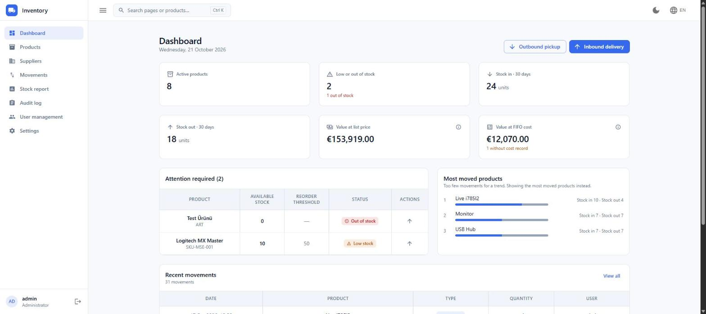
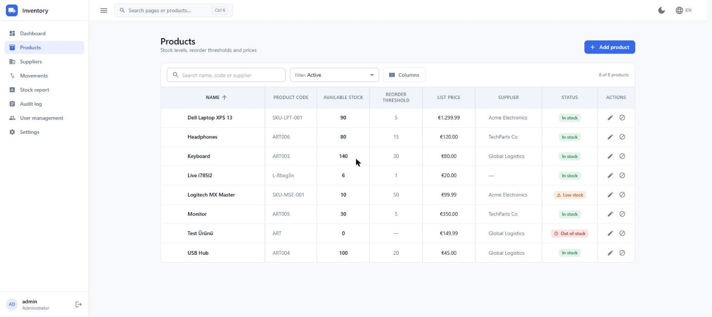
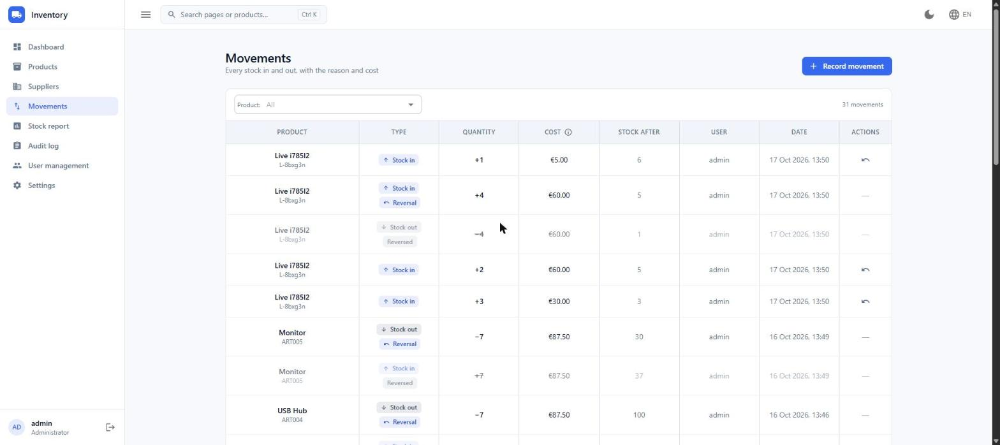
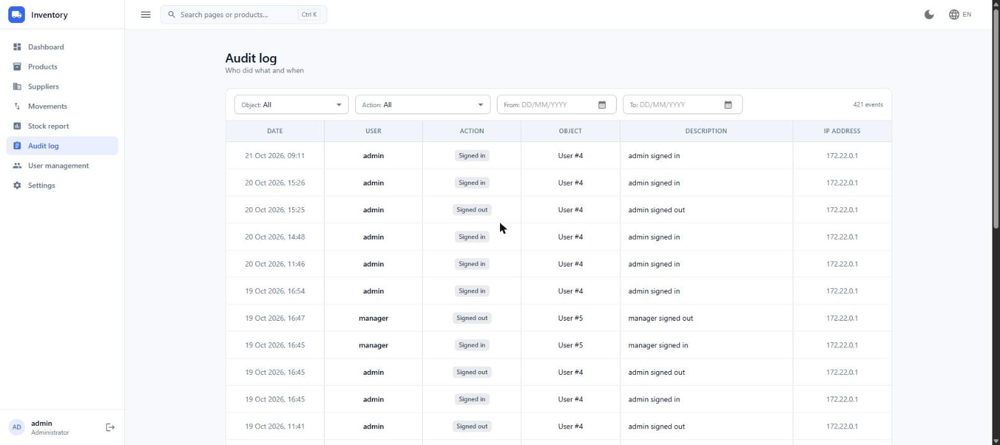
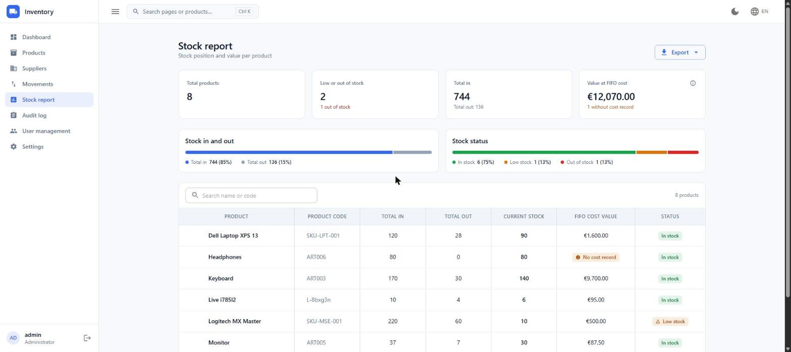
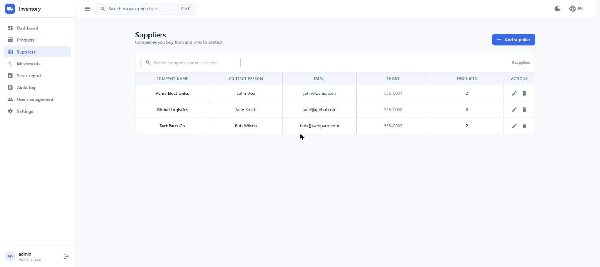
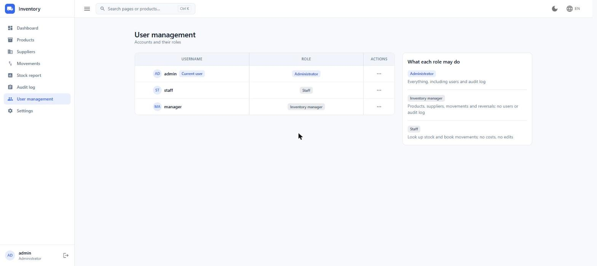
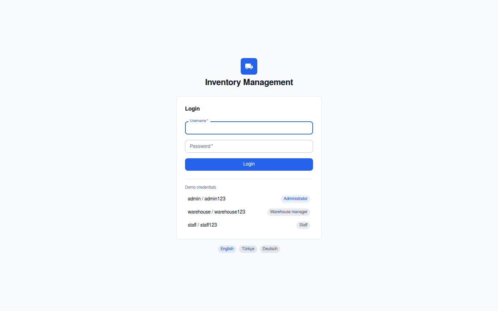
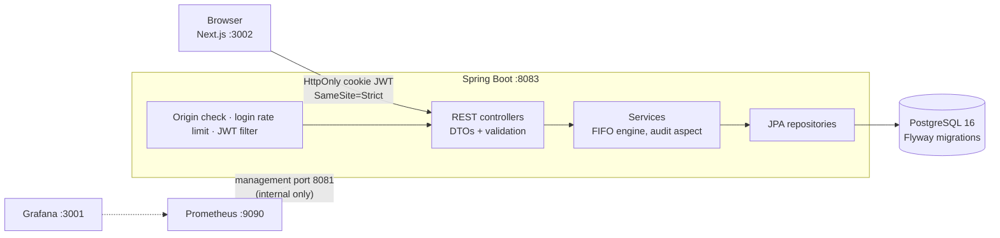

# Inventory: FIFO stock valuation with an append-only ledger (Spring Boot, PostgreSQL)

[](https://github.com/eucardeveloper/inventory-management-api/actions/workflows/ci.yml) [](https://github.com/eucardeveloper/inventory-management-api/actions/workflows/frontend.yml) [](https://github.com/eucardeveloper/inventory-management-api/actions/workflows/e2e.yml)

An inventory management system built around FIFO stock valuation: every receipt becomes a lot with its own cost, issues consume the oldest lot first, and every movement is an append-only ledger row that can only be corrected by a reversal. Also products, suppliers, reports and an audit log. Spring Boot REST API, PostgreSQL, a Next.js dashboard, and Prometheus/Grafana monitoring. Runs locally with one command.

## What this project demonstrates

- **Correct stock valuation under concurrency**: FIFO lots, pessimistic locking per product, idempotency keys, and tests that run on a real PostgreSQL (Testcontainers), including simultaneous requests.
- **An auditable ledger**: movements are never edited; a mistake is a reversal with a reason code, and a reversal takes the units out of the lot the receipt created.
- **Role-based access enforced in the API**, not only in the UI, with a test that calls every route without a token, with a forged token and as the weakest role.
- **Operations basics**: Flyway migrations, CI (backend, frontend, Playwright end to end), Prometheus and Grafana, architecture decision records, documented limitations.

## AI assistance

This project was built with AI coding assistance (Claude). The design decisions are written up in `docs/adr/`, and the tests are the evidence of what works. The owner reviews and is accountable for every change; this section exists so that nobody has to guess.

## Bugs found in review, and how they were fixed

An independent review of this repository (AI-assisted, see above) reproduced real defects. Each was confirmed against the code, fixed, and covered by a test that runs on a real PostgreSQL.

1. **Reversing a receipt corrupted the stock value.** The reversal took the units out of the *oldest* lot and booked the original total. With 10 units at 1.00 and 10 at 5.00, reversing the second receipt left a stock value of 50.00 instead of 10.00. Now a lot is linked to the receipt that created it (`source_movement_id`), the reversal takes the units out of that lot and books the cost of the goods actually removed, and a receipt whose lot was partly sold is refused. Receipts booked before the link existed keep the old path. Tests: `ReverseMovementTest`.
2. **The same idempotency key sent concurrently returned 500.** The key was checked before the product row was locked, so eight simultaneous requests all passed the check; seven then hit the unique constraint and failed inside a broken transaction. The check now runs after the lock, so the requests queue and each later one gets a clean `409` with `existingMovementId`. The old test was sequential and could not have caught this; the new one fires eight requests at once. Test: `ConcurrentStockMovementTest`.
3. **Audit rows were written twice and without an entity id for `void` methods.** Two advices matched the same methods. There is now one advice, and the id comes from the first numeric argument when there is no return value. Test: `AuditTrailTest`.

Smaller fixes from the same review: a password change now revokes the user's refresh tokens, the movement dialog keeps one idempotency key per dialog (it used to create a new one on every click, which defeated the protection), and graceful shutdown is actually configured.

## Review it in five minutes

If you have a few minutes, these are the places that show how the project is built (all paths are in this repository):

| Question | Where to look |
|---|---|
| Does it build and pass tests? | The CI, Frontend and E2E badges above; the workflows are in `.github/workflows` |
| How is stock valued (FIFO) and why is it safe under concurrency? | `src/main/java/com/enesucar/inventory/service/FifoInventoryService.java`, `StockMovementService.java`, `docs/adr/ADR-002-fifo-inventory-engine.md`, `ADR-004-pessimistic-locking-fifo.md` |
| Why can a movement not be edited or deleted? | `docs/adr/ADR-005-append-only-ledger.md` (corrections are reversals with a reason code) |
| Who may do what, and where is it enforced? | `security/SecurityConfig.java` plus `@PreAuthorize` on the controllers, `docs/ROLE-MATRIX.md`, `docs/adr/ADR-006-authorization-model.md` |
| How is the session handled? | `docs/adr/ADR-003-httponly-cookie-jwt.md`, `service/RefreshTokenService.java`, `security/CookieFactory.java` |
| How are changes traced? | `aspect/AuditAspect.java`, `service/AuditLogService.java`, the Audit log screen |
| What is known to be missing? | [Known limitations](#known-limitations) |
| How do I check it myself? | `docs/UAT-GUIDE.md` (acceptance walk-through per role) and `docs/TEST-SCENARIOS.md` (what was run and what was not) |

## Screenshots

Captured at 1440x900 from the real frontend code against a small throwaway mock API (not the Spring backend), so the numbers are sample data. Their fonts are Helvetica-metric stand-ins because the capture machine has no Inter or Segoe UI.

| Dashboard | Products |
| --- | --- |
|  |  |
| Movements | Audit log |
|  |  |
| Stock report | Suppliers |
|  |  |
| Users | Login |
|  |  |

The eight main screens above were captured from the current build. [docs/screenshots](docs/screenshots) also holds older captures (empty, loading and error states, German and Turkish, dark mode, 1920x1080) taken before the latest table redesign.

## Architecture



Design decisions are recorded in `docs/adr/` (monolith over microservices, FIFO engine, HttpOnly cookie JWT, pessimistic locking, append-only ledger, authorization model).

| Layer | Technology |
|-------|-----------|
| Backend | Java 21, Spring Boot 4.1, Spring Security, JPA, Flyway |
| Frontend | Next.js 16, React, TypeScript, MUI 5, TanStack Query |
| Database | PostgreSQL 16 |
| Observability | Actuator, Micrometer, Prometheus, Grafana |
| Quality | JUnit 5, Testcontainers (PostgreSQL), ArchUnit, JaCoCo, OWASP dependency check, GitHub Actions |

## Run it locally

Requirements: Docker Desktop.

```bash
git clone https://github.com/eucardeveloper/inventory-management-api.git
cd inventory-management-api
docker compose up --build
```

The first build takes a few minutes. It works without any configuration: `docker-compose.yml` carries clearly marked development defaults.

To use your own secrets, copy `.env.example` to `.env` (git-ignored) and replace the placeholders: `JWT_SECRET` (at least 32 random bytes), `POSTGRES_PASSWORD`, `GRAFANA_PASSWORD`. `APP_DOCS_ENABLED` switches Swagger UI on or off. The file contains placeholders only; never commit a real `.env`.

Without Docker (backend only, PostgreSQL on the configured datasource): `./mvnw spring-boot:run -Dspring-boot.run.profiles=local`. The `local` profile is opt-in; without a profile the app refuses to start because it has no secrets.

| What | URL |
|------|-----|
| Inventory app | http://localhost:3002 |
| API | http://localhost:8083 |
| Swagger UI | http://localhost:8083/swagger-ui.html (ADMIN login required; on in the compose demo, off by default elsewhere, see `APP_DOCS_ENABLED`) |
| Prometheus | http://localhost:9090 |
| Grafana | http://localhost:3001 (admin / admin, demo only; port busy? set `GRAFANA_PORT=3003` in `.env`) |

Actuator runs on a separate management port (8081) that is reachable only inside the Docker network, so metrics and health details are never on the public API port.

### Your data survives restarts

Database data lives in a named Docker volume. `docker compose up -d` after a reboot or after `docker compose stop` / `down` brings everything back with all records intact; containers also restart automatically (`restart: unless-stopped`). The only command that deletes the data is `docker compose down -v` (or `docker volume rm`), so do not use `-v` unless you want a clean slate.

### Demo accounts

| Username | Password | Role |
|----------|----------|------|
| `admin` | `admin123` | ADMIN |
| `manager` | `manager123` | INVENTORY_MANAGER |
| `staff` | `staff123` | STAFF |

The login screen shows these accounts as a one-click shortcut only when the frontend is built with `NEXT_PUBLIC_SHOW_DEMO_LOGIN=true`. The compose file turns it on for the local demo; set `SHOW_DEMO_LOGIN=false` in `.env` (or leave the build arg unset) for anything public.

Demo users, products, lots and movements come from `src/main/resources/db/demo`, which only the `local` profile and the compose file add to Flyway. A real deployment uses `db/migration` only and has no seeded accounts; create the first admin out of band.

## Frontend development with hot reload

`docker compose up` runs the production build, so a UI change needs a rebuild. For day-to-day UI work use the dev override, which runs `next dev` inside the container with the source mounted:

```bash
docker compose -f docker-compose.yml -f docker-compose.dev.yml up -d --build inventory-frontend
```

Open http://localhost:3002; saved changes under `frontend/inventory-app/src` appear in the browser within seconds. `docker compose up -d --build inventory-frontend` switches back to the production build. The override is not used by CI or by the default setup.

## Roles

| Area | ADMIN | INVENTORY_MANAGER | STAFF |
|------|-------|-------------------|-------|
| Read dashboard, products, suppliers, movements, stock report | yes | yes | yes (costs and prices masked) |
| Record stock in / out | yes | yes | yes (a stock-in needs a unit cost) |
| Reverse a movement | yes | yes | no |
| Create/update/deactivate products, create/update suppliers | yes | yes | no |
| Delete a supplier | yes | no | no |
| Audit log, user management (list, role, password reset, delete) | yes | no | no |
| Change own password (current password required) | yes | yes | yes |
| Swagger UI / OpenAPI | yes | no | no |

Roles are enforced in the API on every request (`SecurityConfig` plus `@PreAuthorize`); the web app hides what a role cannot do, and its tests (`permissions.test.ts`) mirror this table. The Next.js proxy (`src/proxy.ts`) only improves navigation. The last remaining ADMIN can neither be demoted nor deleted (`409`).

## Inventory model

- Stock is never edited directly: `product.stock` is read-only for clients and always equals the sum of `lot.remaining_quantity`. Receipts create lots, issues consume lots FIFO.
- Concurrent issues on the same product take a pessimistic lock (`SELECT ... FOR UPDATE`), see ADR-004.
- The database enforces the invariants too: `CHECK` constraints for non-negative stock and for `0 <= remaining_quantity <= quantity`. Migration `V10` adds checks for positive movement quantities and non-negative costs and prices, plus indexes on the foreign keys that lacked one (product supplier, reversal link, lot consumption, lot source movement).
- Time zone: everything runs in UTC (JVM default, Hibernate JDBC time zone, Jackson, container `TZ=UTC`). Timestamps are stored and sent in UTC; movement timestamps carry no offset in JSON and are UTC by definition, and the web app converts them to the browser's local time for display.
- Every movement is an append-only ledger row with a running `stock_after`.
- Product and supplier endpoints use request/response DTOs, so entities and internal fields are not exposed and unknown JSON fields are ignored.

## Security model

- **Auth**: JWT in an `HttpOnly`, `SameSite=Strict` cookie, `Secure` by default (an explicit property turns it off for plain-HTTP localhost). Scripts on the page cannot read the cookie. The login response body also returns the access token for non-browser clients (scripts, tests), and the API accepts it as a `Bearer` header; the browser app itself uses only the cookie.
- **CSRF**: stateless JWT does not remove CSRF risk when the browser sends the token automatically. Protection is layered: `SameSite=Strict`, an `Origin`/`Referer` check on state-changing requests against `app.cors.allowed-origins`, and JSON-only bodies.
- **Endpoints**: every `/api/**` route needs a valid token and the right role; anonymous calls get `401`, a valid token with too weak a role gets `403`. `POST /api/auth/register` (create an account with any role) is ADMIN only, and a token stops working as soon as its user is deleted. `ApiAuthorizationTest` calls every route without token, with a forged token and as STAFF.
- **Brute force**: login and register are limited to 10 attempts per minute per client address (in memory, per instance).
- **Secrets**: no signing key or DB password is hard-coded in the application. The app refuses to start with a missing or short `JWT_SECRET` (< 32 bytes). The `local` profile and the compose file carry clearly marked development values.
- **Errors**: one JSON format everywhere, RFC 7807 `application/problem+json` (`type`, `title`, `status`, `detail`, plus `fieldErrors` for validation). Validation failures are `400`, missing or bad credentials `401`, a role that is too weak `403`, optimistic/pessimistic lock failures, constraint violations and the last-admin rule `409`, rate limiting `429`. Unexpected errors are logged and return a generic `500` without internals. The same format is used by the security filters and the rate limiter.
- **Passwords**: any signed-in user changes their own password with `PATCH /api/users/me/password` (current password required, 8 to 100 characters). An ADMIN resets another user's password with `PATCH /api/users/{id}/password`.
- **Rate limiter memory**: the per-client login counters are capped (`app.login-rate-limit.max-clients`, default 10000, least recently used first) and expired entries are swept, so a flood of addresses cannot grow the map without bound.
- **API docs**: Swagger UI and `/v3/api-docs` require the ADMIN role and are disabled unless `APP_DOCS_ENABLED=true` (the `local` profile and the compose demo enable them).
- **Container**: the backend image runs as a non-root user and `.dockerignore` keeps build output, VCS data and local env files out of the build context.
- **Dependencies**: OWASP dependency check runs weekly in CI. It is non-blocking at the moment and its last run before the Spring Boot 4 migration listed high-severity findings against the 3.5 line; it has not been re-run on 4.1 yet, so whether they are gone is unknown. See Known limitations.

For anything beyond a local demo, set `JWT_SECRET`, `POSTGRES_PASSWORD` and `GRAFANA_PASSWORD` in a `.env` file and set `APP_DOCS_ENABLED=false`.

## Tests

```bash
./mvnw verify          # 123 backend tests (unit + integration), JaCoCo report in target/site/jacoco
```

Integration tests use Testcontainers and need Docker. On a machine without Docker they are skipped locally; when the `CI` environment variable is set (as on GitHub Actions) a missing Docker daemon fails the build instead of skipping. They include a concurrency test for the FIFO lock and a stock-invariant test that applies 200 random movements to a real PostgreSQL and checks `stock = sum(lots)` and the CHECK constraints. CI uploads the JaCoCo report as an artifact.

Frontend:

```bash
cd frontend/inventory-app && npm ci && npm run lint && npm test && npm run build   # 92 unit tests
```

## API summary

```
POST   /api/auth/login | /logout | /refresh      (public)
POST   /api/auth/register                       (ADMIN only)
GET    /api/products | /active | /low-stock | /{id} | /{id}/lots | /{id}/valuation | /valuation/total
POST   /api/products   PUT /api/products/{id}   DELETE /api/products/{id}   (ADMIN, INVENTORY_MANAGER; delete deactivates)
GET    /api/stock/movements | /movements/{id}          (all roles)
POST   /api/stock/movements                            (all roles; stock-in needs unitCost)
POST   /api/stock/movements/{id}/reverse               (ADMIN, INVENTORY_MANAGER)
GET    /api/stock/report                               (all roles; costs masked for STAFF)
GET    /api/suppliers | /{id}   POST, PUT                  (PUT/POST: ADMIN, INVENTORY_MANAGER)
DELETE /api/suppliers/{id}                                 (ADMIN)
GET    /api/audit                                          (ADMIN)
GET    /api/users | /{id}   PATCH /{id}/role | /{id}/password   DELETE /{id}   (ADMIN)
PATCH  /api/users/me/password                              (any signed-in user)
```

Full request/response schemas are in Swagger UI.

## Known limitations

- The project moved from Spring Boot 3.5 (open-source support ended 2026-06-30) to 4.1. What changed in the code: the starters were renamed (`webmvc`, `flyway`, `aspectj`), springdoc is on 3.x, Testcontainers on 2.x, and `DaoAuthenticationProvider` now takes its `UserDetailsService` in the constructor (Spring Security 7). Checked by CI: all backend tests, a real-HTTP scrape of `/actuator/prometheus` (including the latency histogram) and the full-stack E2E run. Not checked: the weekly OWASP scan has not been re-run on 4.1, so any remaining findings are unknown, and the job stays non-blocking until it has been triaged. jjwt 0.13 still uses Jackson 2 while Boot 4 uses Jackson 3, so both are on the classpath; the application's own code uses neither directly.
- A repeated idempotency key is answered with `409` and the id of the original movement (`existingMovementId`), not with the original movement itself.
- The dashboard KPIs and the movement trend chart use the latest 200 movements, not the full history.
- End-to-end coverage is a Playwright suite (`e2e/`, run by the `E2E` workflow; 13 tests, run on every push to `main`): sign-in, session cookies, every main screen, booking a stock-in and reversing it, cost masking for STAFF, and API-level rule checks (cost required on receipts, refusal of over-issue, FIFO lot order, reversal rules, idempotency key, role limits, last administrator). The remaining browser scenarios are only listed, not automated; see `docs/UX-REVIEW.md` for the UI guidelines and what has been checked, `docs/TEST-SCENARIOS.md` for the recommended end-to-end scenarios and `docs/CASE-STUDY.md` for the project write-up.
- The stock report exports to CSV, Excel and PDF. The files are built in the browser from the report on screen: CSV follows RFC 4180 and neutralises spreadsheet formulas, Excel is the SpreadsheetML `.xls` format (Excel may warn about the extension), and PDF opens a print view to save as PDF. There is no server-side export endpoint.
- Settings (workspace, notifications) are stored in the browser only, because the API has no settings endpoint. The email digest is a stored preference; nothing sends email. Theme and language are applied by the app and stored under their own keys.
- The login rate limiter is per process; several instances would need a shared store. It keys on the TCP peer address; behind a reverse proxy set `APP_TRUST_FORWARDED_FOR=true` so the last `X-Forwarded-For` entry (the one the trusted proxy appended) is used instead, otherwise every user shares the proxy's address. The same address is written to the audit log.
- Migrations: `V7` is skipped: the number was used only on a side branch that was never merged into `main`, and Flyway does not require gapless versions; `V11` renamed the manager role to `INVENTORY_MANAGER` and rewrote the stored demo user name in `audit_log` and `stock_movement` so existing databases match the seeded demo account.
- The application connects as the `postgres` superuser, and the same account runs the Flyway migrations and the application queries. The database port is published on `127.0.0.1` only, as are Prometheus and Grafana; a production setup would use a migration owner and a separate least-privilege runtime role.
- Running the Java build and the compose stack requires Maven Central and Docker Hub access.

## License

MIT, see `LICENSE`.
